## Hey, I'm Lucas 

**AI Engineer** at Fenox Tecnologia · 📍 São José dos Campos, Brazil

### What I do

- 🤖 Put AI coding agents to work on real production code, and keep them cheap and in line
- ⚙️ Build CI/CD for the team: GitHub Actions, self-hosted runners, deploys a human has to approve
- 📱 Android apps with Kotlin and Jetpack Compose
- 🗄️ Backend in C#, .NET and SQL Server, which is where I started

### Tools I use

### Side projects

| | Project | What it is |
|---|---|---|
| 🧩 | [friday_agents](https://github.com/LucasEdu07/friday_agents) | Local AI agents with memory · Python |
| 💼 | [StarFireCRM](https://github.com/LucasEdu07/StarFireCRM) | A small offline CRM for desktop · C# / WPF |
| 🚗 | [OBDIIApp](https://github.com/LucasEdu07/OBDIIApp) | Talks to a car's OBD-II adapter over Bluetooth · C# |

### Activity

<picture>
  <source media="(prefers-color-scheme: dark)" srcset="https://raw.githubusercontent.com/LucasEdu07/LucasEdu07/output/pacman-contribution-graph-dark.svg">
  <source media="(prefers-color-scheme: light)" srcset="https://raw.githubusercontent.com/LucasEdu07/LucasEdu07/output/pacman-contribution-graph.svg">
  
</picture>

Most of my work lives in private repos, so the graph tells more than the repo list.
